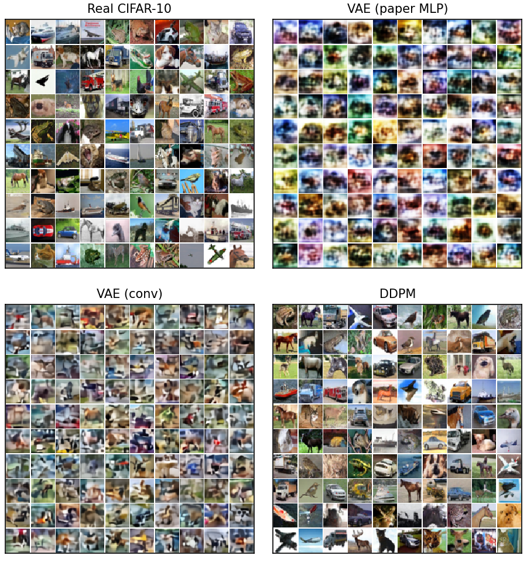
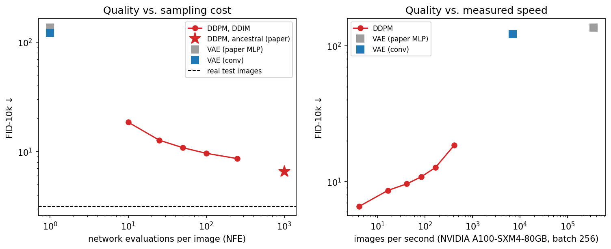

# VAE vs. DDPM on CIFAR-10: Implemented from Scratch

[](https://github.com/Eyad-Elnakib1/Generative-models-VAE-DDPM/actions/workflows/tests.yml)
[](pyproject.toml)
[](https://pytorch.org)
[](LICENSE)
[](https://colab.research.google.com/github/Eyad-Elnakib1/Generative-models-VAE-DDPM/blob/main/notebooks/colab_runner.ipynb)

This repository implements two foundational deep generative models from the ground up in PyTorch, trains them on
CIFAR-10, and compares them quantitatively and qualitatively under a single evaluation protocol:

- the **Variational Autoencoder (VAE)** of Kingma & Welling (2014);
- the **Denoising Diffusion Probabilistic Model (DDPM)** of Ho et al. (2020).

No generative-model library is used: networks, losses, samplers, the likelihood bound and the training loop are all
written here. 32 automated tests cover the core mathematics, the training loop, the metrics and notebook consistency.

**[Read the report (PDF)](report/VAE_vs_DDPM_Report.pdf)** · [LaTeX source](report/latex/) ·
[All results](results/) · [Colab notebook](notebooks/colab_runner.ipynb) ·
[Trained models & raw outputs (Google Drive)](https://drive.google.com/drive/folders/1SH42and7yRTIOOh9D9E-YndSEQ0Ilfb4?usp=sharing)

<p align="center">
  
  <br><em>Uncurated samples (first 100 of a fixed seed) next to real CIFAR-10 test images.</em>
</p>

---

## Contents
- [Key results](#key-results)
- [The three models](#the-three-models)
- [The main difference between a VAE and a DDPM](#the-main-difference-between-a-vae-and-a-ddpm)
- [Repository structure](#repository-structure)
- [Installation](#installation)
- [Reproducing the results](#reproducing-the-results)
- [Trained models and raw outputs](#trained-models-and-raw-outputs)
- [Evaluation protocol](#evaluation-protocol)
- [Testing](#testing)
- [Faithfulness to the papers and limitations](#faithfulness-to-the-papers-and-limitations)
- [Citation](#citation) · [License](#license)

---

## Key results

Final EMA checkpoint of one training run per model. Sample-based metrics use 10,000 generated samples against the
50,000 CIFAR-10 training images (FID-10k). All models were trained and timed on one NVIDIA A100-SXM4-80GB
(throughput: bf16, batch 256).

| Model | FID ↓ | IS ↑ | Precision ↑ | Recall ↑ | NLL bound (bits/dim) ↓ | Network evals / image | Images/s ↑ | Params | Train GPU-h |
|---|---|---|---|---|---|---|---|---|---|
| *Real test images* | *3.15* | *10.97* | *0.68* | *0.69* | – | – | – | – | – |
| VAE, paper MLP | 136.0 | 3.11 | 0.32 | 0.003 | 6.31 | 1 | 350,102 | 4.9M | 0.44 |
| VAE, conv | 121.9 | 3.88 | 0.40 | 0.07 | 5.83 | 1 | 7,017 | 30.4M | 1.32 |
| **DDPM**, 1000 steps | **6.58** | **8.59** | **0.69** | **0.58** | **3.79** | 1000 | 4.2 | 35.7M | 3.94 |
| DDPM, DDIM 10 steps | 18.55 | 7.72 | 0.60 | 0.51 | 3.79 | 10 | 416 | 35.7M | 3.94 |

**Bits/dim** is an upper bound on the test-set negative log-likelihood of the 8-bit images (lower is better):
- for the DDPM, the full variational bound with σ²ₜ = βₜ, on 1,000 test images;
- for the VAEs, the negative ELBO with one latent sample on uniformly dequantised pixels, on all 10,000 test images.

It is a property of the trained model, not of the sampler, so both DDPM rows share it.

**Paper reference.** The DDPM paper reports FID 3.17 and IS 9.46 (50,000 samples, best checkpoint over 800k
steps) and ≤ 3.75 bits/dim. Our values describe the checkpoints evaluated here (a shorter run, FID-10k, final
checkpoint), so they are not directly equivalent to the paper's.

<p align="center">
  
</p>

**Findings:**
- **The DDPM outperforms both VAEs on every sample-quality metric measured.**
  - FID 18.5× lower than VAE-Conv.
  - Precision at the level of real images (0.69 vs. 0.68), and 8× the recall.
  - A lower likelihood bound (3.79 vs. 5.83 bits/dim).
  - In a blind rating by one vision-language model (Gemini), 48 of 50 DDPM samples and 48 of 50 real images were
    judged real, i.e. chance-level discrimination.
- **The VAE samples far faster.** It needs 1 network evaluation per image instead of 1000. In our benchmark this
  gave about 1,700× higher throughput (7,017 vs. 4.2 images/s), a measurement for this hardware and batch size,
  not a general end-to-end speed-up.
- **DDIM trades quality for speed** with the same trained network. 10 steps are about 100× faster than the
  1000-step sampler but raise FID from 6.58 to 18.55, which is still 6.6× lower than VAE-Conv.
- **The likelihood bound is consistent with the paper:** 3.79 vs. ≤ 3.75 bits/dim, after 19% of the paper's
  training steps. This supports consistency with the reference, but does not on its own establish that every
  component is correct; the core mathematics is checked separately by the tests.
- **The VAE's main weakness is coverage, not only blur.** Its reconstructions of test images (FID 57.9) are far
  better than its samples from the prior (FID 121.9). This gap supports a "prior hole" interpretation, in which
  latents drawn from N(0, I) often fall where the decoder received little training signal, but does not prove it
  on its own.
- **A convolutional network improves the VAE** over the paper's MLP on most metrics, but its samples remain blurry
  and low in diversity.
- **A nearest-neighbour check finds no evidence of copying.** In Inception feature space, DDPM samples are about as
  close to their nearest training image as unseen test images are (median distance ratio 1.02). Only 0.09% fall
  below the test images' 1st percentile, against 1% for unseen real images by construction. This check does not
  rule out memorisation in general.

The [report](report/VAE_vs_DDPM_Report.pdf) has the full analysis: 31 pages with 18 figures, 13 tables and 4
algorithms. Its sections cover architectures, equations, algorithms, training dynamics, the likelihood
decomposition, thematic consistency, latent spaces, a blind rating and limitations.

## The three models

| | **VAE-MLP** | **VAE-Conv** | **DDPM** |
|---|---|---|---|
| Source | Kingma & Welling (2014): paper's network, for 32×32 RGB input | Kingma & Welling (2014) *method*, conv network | Ho et al. (2020): paper's CIFAR-10 architecture and core hyper-parameters, 150k of 800k steps |
| Network | 3072 → 500 (tanh) → z ∈ ℝ²⁰⁰ → 500 (tanh) → 3072 | ResNet encoder/decoder (24 residual + 7 attention blocks), z ∈ ℝ¹²⁸ | U-Net (22 residual + 6 attention blocks, 12 skip connections) |
| Parameters | 4.9M | 30.4M | 35.7M |
| Encoder | learned | learned | fixed Gaussian noising (no parameters) |
| Objective | ELBO, β = 1 | ELBO, β = 1 | L_simple (reweighted ELBO) |
| Sampling | 1 decoder pass | 1 decoder pass | 1000 denoising steps (10–250 with DDIM) |

- **VAE-Conv** uses the **same residual/attention blocks and channel widths as the DDPM's U-Net** and a similar
  parameter count (30.4M vs. 35.7M). This narrows the architectural gap in the VAE-vs-DDPM comparison but does
  not make it fully controlled. The U-Net still differs in several ways:
  - it has skip connections and timestep conditioning;
  - it is trained with a different objective;
  - its training budget differs (150k vs. 60k steps).
- **VAE-MLP** shows the original network as published, and how much the network alone matters.

Layer-by-layer tables and diagrams of all three are in Section 3 of the report.

## The main difference between a VAE and a DDPM

Conceptually, a DDPM is a latent-variable model trained with a variational bound. Its bound has the same form as
that of a hierarchical VAE with 1000 latent layers. The analogy is useful but not an identity, because in a DDPM:
- the "encoder" (adding noise) is **fixed instead of learned**;
- every latent is the **same size as the image**, so nothing is compressed;
- the prior is **matched by construction**;
- training uses a reweighted bound (L_simple) rather than the ELBO itself.

A VAE instead **learns** an encoder into a small latent space and decodes in **one** step, with independent
Gaussian pixels. These design differences, together with differences in network architecture (for example the
U-Net's skip connections), training objective and training budget, are consistent with the measured differences:

| VAE | DDPM |
|---|---|
| One factorised decoding step → blurry averages, low precision | Many small denoising steps, each easy to model → sharp, realistic samples |
| Encoder must compress *and* match N(0, I) → low recall, consistent with a prior hole | Prior term of the bound negligible by construction (L_T = 8·10⁻⁶ bits/dim) |
| 1 network evaluation → ~1,700× higher measured throughput | 1000 network evaluations (DDIM: 10–250) |
| Smooth, semantic latent space and an encoder | No learned representation (its latent is noise) |

## Repository structure

```
├── pyproject.toml               package definition (genmodels) and optional extras [eval], [dev]
├── requirements.txt             the same dependencies as a flat list
├── LICENSE · CITATION.cff       MIT licence and citation metadata
├── .github/workflows/tests.yml  CI: runs the test suite on CPU for every push
├── configs/                     one YAML per experiment; every hyper-parameter lives here
│   ├── ddpm_cifar10.yaml        DDPM, Ho et al. (2020) CIFAR-10 settings
│   ├── vae_conv_cifar10.yaml    VAE, convolutional network
│   └── vae_mlp_cifar10.yaml     VAE, the paper's MLP network
├── src/genmodels/               the library (all models written from scratch)
│   ├── nn_blocks.py             ResNet block, self-attention, resampling, time embedding, init
│   ├── unet.py                  DDPM noise-prediction U-Net (35.7M parameters)
│   ├── diffusion.py             forward process, L_simple, ancestral + DDIM samplers, bound in bits/dim
│   ├── vae.py                   VAE method + MLP and convolutional networks
│   ├── trainer.py               shared training loop: bf16, EMA, warm-up, clipping, resumable checkpoints
│   ├── data.py                  CIFAR-10 on the GPU with deterministic, resumable shuffling
│   └── eval/                    metrics, CIFAR-10 classifier, sampling utilities
├── scripts/
│   ├── train.py                 train or resume a model
│   ├── benchmark.py             measure speed on a GPU and project the compute cost
│   ├── train_classifier.py      classifier used to measure thematic consistency
│   ├── evaluate.py              the full evaluation protocol (resumable)
│   ├── make_figures.py          result tables and figures
│   ├── plot_training_logs.py    training curves from the logs
│   ├── blind_rating.py          blind rating by a person or an external model
│   └── build_notebook.py        regenerates the Colab notebook from the repository files
├── notebooks/
│   ├── colab_runner.ipynb           self-contained Colab notebook (the full code + training + evaluation)
│   └── colab_runner_executed.ipynb  the executed notebook of the reported runs, with all outputs
├── results/                     every number and figure of the report (see results/README.md)
├── report/
│   ├── VAE_vs_DDPM_Report.pdf   the report (31 pages)
│   └── latex/                   its LaTeX source (main.tex, sections/, references.bib)
└── tests/                       32 tests: maths, training loop, metrics, notebook consistency
```

## Installation

Python ≥ 3.10 and PyTorch ≥ 2.2.
- **Needs a CUDA GPU:** training, `scripts/evaluate.py`, `scripts/benchmark.py` and `make_figures.py --model-figures`.
- **Runs on CPU:** the test suite.

```bash
git clone https://github.com/Eyad-Elnakib1/Generative-models-VAE-DDPM.git
cd Generative-models-VAE-DDPM
pip install -e ".[eval,dev]"
```

If you install from `requirements.txt` instead, also run `pip install -e . --no-deps`, because the scripts import the
`genmodels` package.

Downloads on first use:
- CIFAR-10 (about 170 MB), to `data/`;
- torch-fidelity's Inception weights (about 90 MB), by the evaluation.

## Reproducing the results

**Option 1: Google Colab (what was used).** Open
[`notebooks/colab_runner.ipynb`](https://colab.research.google.com/github/Eyad-Elnakib1/Generative-models-VAE-DDPM/blob/main/notebooks/colab_runner.ipynb),
select an A100 or L4 GPU, and run it top to bottom.
- It contains the complete code and stores all runs on Google Drive.
- After a disconnect, re-running the setup and training cells resumes from the last checkpoint (saved every
  15 minutes).
- The executed version with all outputs is
  [`notebooks/colab_runner_executed.ipynb`](notebooks/colab_runner_executed.ipynb).

**Option 2: command line.**

```bash
# 1. Train (re-running a command resumes from the last checkpoint); times measured on the A100
python scripts/train.py --config configs/vae_mlp_cifar10.yaml       # 0.44 GPU-hours
python scripts/train.py --config configs/vae_conv_cifar10.yaml      # 1.32 GPU-hours
python scripts/train.py --config configs/ddpm_cifar10.yaml          # 3.94 GPU-hours (150k steps)

# 2. Evaluate (resumable; results cached in runs/eval/)
python scripts/train_classifier.py --out runs/classifier
python scripts/evaluate.py      # dominated by DDPM sampling (~1.3 A100-hours projected by scripts/benchmark.py)

# 3. Tables and figures (written to runs/eval/report/)
python scripts/make_figures.py --model-figures
python scripts/plot_training_logs.py --runs runs --out runs/eval/report/fig_training_curves.png
```

Optional: `python scripts/benchmark.py --units-per-hour <rate>` measures training and sampling speed on your GPU
and projects the total cost before you commit to a run.

**Building the report:** `cd report/latex && tectonic main.tex`. The included PDF was built with Tectonic 0.15
(XeTeX).

| Compute used (A100-SXM4-80GB) | GPU-hours |
|---|---|
| VAE-MLP (500k steps) | 0.44 |
| VAE-Conv (60k steps) | 1.32 |
| DDPM (150k steps) | 3.94 |
| Classifier (30 epochs) | 0.02 |
| **Training total** | **5.72** |

## Trained models and raw outputs

Files too large for git are in a public Google Drive folder:
**[vae-vs-ddpm (Google Drive)](https://drive.google.com/drive/folders/1SH42and7yRTIOOh9D9E-YndSEQ0Ilfb4?usp=sharing)**.
It contains the `runs/` directory of the reported experiments and a copy of the CIFAR-10 archive. The layout below
is the one written by the training and evaluation scripts:

| Path in the Drive folder | Contents |
|---|---|
| `runs/<model>/ema_final.pt` | Trained weights (EMA and raw) of each model, used for all reported results |
| `runs/<model>/ckpt_last.pt` | Full training state (model, EMA, optimiser, RNG), for resuming or extending training |
| `runs/<model>/snapshots/` | EMA weights every 10k steps, used for the FID-during-training curves |
| `runs/<model>/samples/`, `metrics.jsonl`, `config.yaml` | Progress sample grids, training log and exact config |
| `runs/classifier/classifier.pt` | The CIFAR-10 classifier used for the thematic-consistency metrics |
| `runs/eval/` | Every generated sample set (`samples/*.npz`, 10,000 images each), cached Inception reference statistics and all metric files |
| `cifar-10-python.tar.gz` | The CIFAR-10 dataset (also downloaded automatically by the code) |

`<model>` is `ddpm_cifar10`, `vae_conv_cifar10` or `vae_mlp_cifar10`.

**Evaluating the trained models without retraining (CUDA GPU required):**
1. Place the downloaded `runs/` folder in the repository root. The scripts need `runs/<model>/ema_final.pt` and
   `runs/classifier/classifier.pt`.
2. Run `python scripts/evaluate.py`. Results already present in `runs/eval/` are reused, not recomputed. To
   recompute everything from the checkpoints, pass a new directory, e.g. `--eval-dir runs/eval_new`.
3. Run `python scripts/make_figures.py --model-figures`, adding `--eval-dir runs/eval_new` if you used it in step 2.

## Evaluation protocol

All models are evaluated by one script, on the same GPU, with the same Inception features:

| Metric | What it measures |
|---|---|
| **FID**, **IS** | Standard sample-quality metrics (torch-fidelity, TF-compatible Inception) |
| **KID** | Like FID, but unbiased at 10k samples |
| **Precision / recall** (k = 3) | Realism vs. diversity, separately |
| **Bits/dim** | Test-set likelihood bound: DDPM variational bound and VAE ELBO, on the same scale |
| **Speed–quality** | DDIM 10–250 steps vs. the paper's 1000-step sampler, plus measured throughput and latency |
| **Thematic consistency** | A ResNet-18 trained from scratch (93.6%) checks how recognisable samples are and whether all classes appear |
| **Memorisation** | Nearest training image of each sample vs. unseen real images |
| **Blind rating** | 150 shuffled real / VAE / DDPM images rated by a vision-language model (Gemini) |
| **Ablations** | EMA on/off; VAE reconstructions vs. samples (no extra training needed) |

**Safeguards:**
- **Metric sanity check:** before any model was evaluated, the pipeline was run on real data. It gave a test-vs-train
  FID of 3.15 and a test-set IS of 10.97, in line with commonly reported CIFAR-10 values.
- **Real-data reference row** for every metric, to show the ceiling.
- **No cherry-picking:** the final EMA checkpoint of each run was chosen before evaluation, and all grids are
  uncurated.
- **Evaluation noise** is reported over three independent sample sets. Variance across training seeds was not
  measured.

## Testing

```bash
pytest
```

The suite has 32 tests. On a CPU-only machine, the one GPU-only test (resuming training on a GPU) is skipped. On
GitHub Actions' CPU runner it takes about 2–3 minutes. Every test is seeded, so the results are deterministic.

The tests check the mathematics against independent derivations, not just shapes:
- the DDPM posterior against a numerical Bayes computation;
- exact data recovery by both samplers given a perfect noise predictor;
- normalisation of the discretised likelihood;
- the analytic KL terms against Monte Carlo;
- the ELBO's β = 1 scaling;
- that resumed training reproduces an uninterrupted run;
- that precision/recall detects mode collapse;
- the U-Net's parameter count against the paper;
- that the Colab notebook contains exactly the repository's code.

## Faithfulness to the papers and limitations

- **DDPM:** follows the paper's CIFAR-10 architecture and core hyper-parameters (35.7M-parameter U-Net, T = 1000,
  linear β schedule, L_simple, Adam 2·10⁻⁴, batch 128, dropout 0.1, EMA 0.9999, random flips).
  - It was trained for **150k instead of 800k steps** because of the compute budget.
  - FID-5k of the EMA snapshots was still decreasing at the end (14.48 → 14.00 → 13.57 at 130k/140k/150k steps).
    This observed trend suggests longer training could improve the results, but does not guarantee it.
- **VAE:** the method of Kingma & Welling (Gaussian encoder, reparameterisation, N(0, I) prior, analytic KL,
  Gaussian decoder with learned variance, one sample, β = 1). The main VAE replaces the paper's MLP with a
  convolutional network of comparable capacity; the paper's MLP is reported alongside.
- **Evaluation:**
  - **FID uses 10k samples** (the paper: 50k). FID is biased upward at smaller sample sizes, so our values are
    comparable across our models but not directly comparable to published FID-50k.
  - We report the final checkpoint of **one training run per model**, while the paper reports its best checkpoint.
  - The **blind rating** was done by one automated vision-language model (Gemini), not a human study.
  - **Speed figures** are measurements on one A100 (bf16; throughput at batch 256, latency at batch 1). Other
    hardware or implementations will give different numbers.

The report's Section 9 discusses every limitation and how it is addressed.

## Citation

```bibtex
@misc{elnakib2026vaeddpm,
  author       = {Elnakib, Eyad},
  title        = {{VAE} vs. {DDPM} on {CIFAR-10}: Implementation from Scratch, Benchmark and Analysis},
  year         = {2026},
  howpublished = {\url{https://github.com/Eyad-Elnakib1/Generative-models-VAE-DDPM}}
}
```

Citation metadata is also provided in [`CITATION.cff`](CITATION.cff).

## License

Released under the [MIT License](LICENSE).

## Acknowledgements

- D. P. Kingma and M. Welling, *Auto-Encoding Variational Bayes*, ICLR 2014.
- J. Ho, A. Jain and P. Abbeel, *Denoising Diffusion Probabilistic Models*, NeurIPS 2020
  ([official code](https://github.com/hojonathanho/diffusion), which our U-Net follows).
- J. Song, C. Meng and S. Ermon, *Denoising Diffusion Implicit Models*, ICLR 2021.
- [torch-fidelity](https://github.com/toshas/torch-fidelity) for the reference FID / IS / KID implementations.
- The CIFAR-10 dataset (A. Krizhevsky, 2009).
